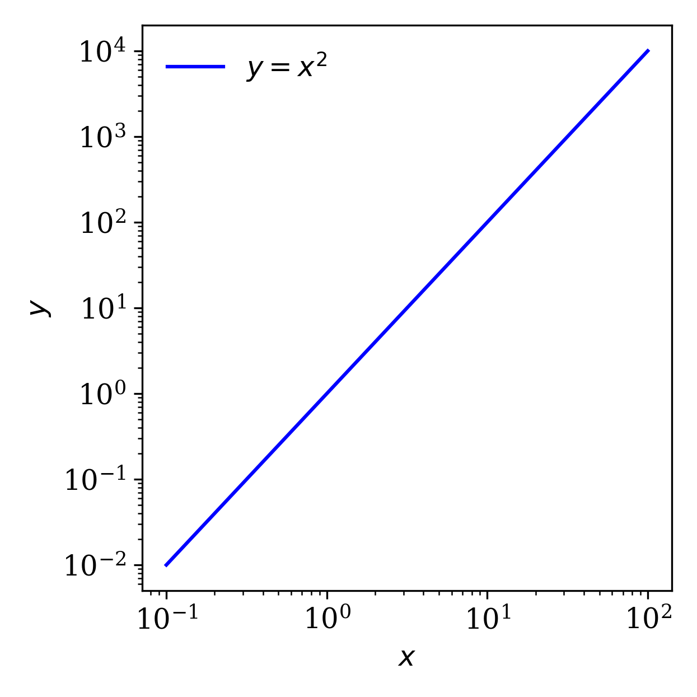
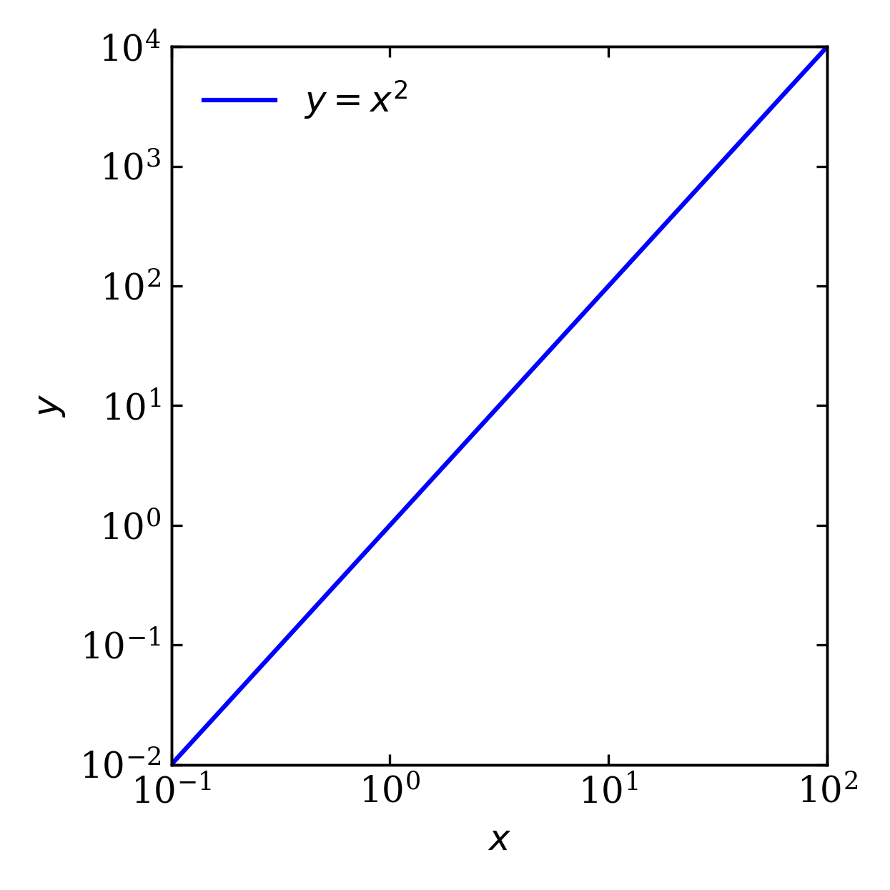

# sciplots

`sciplots` adds small helpers for consistent Matplotlib figures. Set figure
dimensions and typography, configure axis scales and ticks in one call, and add
labels to subplot grids. The result is still a regular Matplotlib figure, so it
works with your existing plotting and export workflow.

## Matplotlib and sciplots

These plots show the same data. The sciplots example applies a consistent style
and configures the axes through `configure_axes`.

<table align="center" style="border: none;">
  <tr>
    <td align="center" style="border: none;">
      <b>Matplotlib</b><br>
      
    </td>
    <td align="center" style="border: none;">
      <b>sciplots</b><br>
      
    </td>
  </tr>
</table>

## Quick start

```python
import numpy as np
import matplotlib.pyplot as plt
import sciplots as spl

spl.set_style(figsize=(4.15, 4.15))

x = np.logspace(-1, 2, 100)
y = x**2

fig, ax = plt.subplots()
ax.plot(x, y, label="data")

spl.configure_axes(
    ax,
    xlabel="x",
    ylabel="y",
    xscale="log",
    yscale="log",
    xlim=(0.1, 100),
    ylim=(0.01, 10000),
)

ax.legend(frameon=False)
fig.tight_layout()
fig.savefig("plot.pdf")
```

## Temporary style

Use `style_context` when you only want the style to apply to one plot or one
section of a notebook:

```python
with spl.style_context(figsize=(3.32, 2.49), font_family="serif"):
    fig, ax = plt.subplots()
    ax.plot([0, 1], [0, 1])
```

## Axes helper

`configure_axes` returns the original Matplotlib axes, so it fits naturally into
existing plotting code. The underlying helper is attached to `ax.sciplots`:

```python
ax = spl.configure_axes(ax, xtwin=True, ytwin=True)
x_twin, y_twin = ax.sciplots.twins
```

Use `xticklabels` and `yticklabels` to set custom tick labels:

```python
spl.configure_axes(
    ax,
    xticks=[0, 1, 2],
    xticklabels=["low", "mid", "high"],
)
```

## Panel labels

Add consistent labels to a subplot grid. Labels default to A, B, C, and
so on, and can be customized with `x`, `y`, and `Axes.text` keyword arguments:

```python
fig, axes = plt.subplots(1, 2)
spl.label_panels(axes, labels=["A", "B"], fontsize=14, x=0.03, y=0.97)
```
